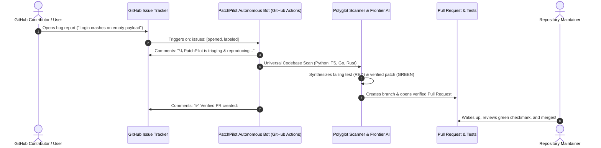

# 🛠️ PatchPilot

<div align="center">

[](https://github.com/subhanirtaza2156/patchpilot)
[](https://opensource.org/licenses/Apache-2.0)
[](#-universal-multi-language-support)
[](#-frontier-reasoning-engines)
[](docs/CONTRIBUTING.md)

**The Autonomous GitHub Action Co-Maintainer for Open Source Repositories.**

*Triages incoming issues while you sleep. Reproduces bugs deterministically. Opens verified Pull Requests with passing tests.*

[Quickstart Action](#-30-second-github-action-setup) • [Architecture](#-how-it-works-while-you-sleep) • [Polyglot Scanner](#-universal-multi-language-support) • [Documentation](docs/) • [Contributing](docs/CONTRIBUTING.md)

</div>

---

## ⚡ The Maintainer Dilemma

When developers write code interactively, they already use IDE assistants like Cursor or Claude Code.

**The real bottleneck happens when the maintainer is AWAY.**
- While you are asleep or at work, users submit bug reports and crash traces on GitHub.
- By the time you sit down to code, you have a backlog of 30 issues to manually reproduce, triage, and test.

## 💡 The Solution: PatchPilot Autonomous Bot

`PatchPilot` is a **Headless Asynchronous Co-Maintainer** packaged as a native GitHub Action. 

When a user opens an issue on your repository, PatchPilot triggers automatically in GitHub Actions, parses the stack trace, indexes your polyglot codebase, creates an isolated branch, verifies a reproduction test (**RED**), synthesizes a fix with frontier reasoning models, ensures test suites pass (**GREEN**), and opens a ready-to-merge Pull Request with an explanatory comment on the issue!



---

## 🚀 30-Second GitHub Action Setup

Add PatchPilot to any open-source repository by dropping this single workflow file into `.github/workflows/patchpilot.yml`:

```yaml
name: PatchPilot Autonomous Co-Maintainer

on:
  issues:
    types: [opened, labeled]

permissions:
  contents: write
  issues: write
  pull-requests: write

jobs:
  triage-and-patch:
    if: contains(github.event.issue.labels.*.name, 'bug') || contains(github.event.issue.title, 'Fix') || contains(github.event.issue.title, 'bug')
    runs-on: ubuntu-latest
    steps:
      - uses: actions/checkout@v4
        with:
          fetch-depth: 0

      - name: Run PatchPilot Co-Maintainer
        uses: subhanirtaza2156/patchpilot@main
        with:
          openai-api-key: ${{ secrets.OPENAI_API_KEY }}
          # Or use Google Gemini 4 Argon:
          # gemini-api-key: ${{ secrets.GEMINI_API_KEY }}
          # llm-provider: "gemini"
```

---

## 🌐 Universal Multi-Language Support

PatchPilot does not rely on single-language parsers. Its **Universal Code Scanner** indexes functions, interfaces, structs, classes, and dependencies across all major ecosystems:

| Language | Supported Extensions | Test Runner Integration |
| :--- | :--- | :--- |
| **Python** | `.py` | `pytest` / `unittest` |
| **TypeScript / JavaScript** | `.ts`, `.tsx`, `.js`, `.jsx` | `jest` / `vitest` / `npm test` |
| **Go** | `.go` | `go test ./...` |
| **Rust** | `.rs` | `cargo test` |
| **C / C++** | `.c`, `.cpp`, `.h` | Native test runners |

---

## 🧠 Frontier Reasoning Engines (BYOK)

PatchPilot connects directly to frontier reasoning models designed specifically for agentic software engineering:

- **OpenAI:** Native integration with **GPT-6.1 Sol** (agentic coding), **GPT-6.1 Terra**, and OpenAI Codex.
- **Google Gemini:** Native integration with **Gemini 4 Argon** (advanced software engineering) and **Gemini 4 Carbon** (cybersecurity & deep reasoning).
- **Local Ollama:** Compatible with **DeepSeek-V4.1-Flash** (1M token context MoE) and **Qwen 2.5 Coder**.
- **Mock Provider:** Deterministic offline mode for testing and CI dry-runs.

---

## 💻 Optional Local CLI Usage

While PatchPilot is built to run headlessly in GitHub Actions, maintainers can also run it locally on their terminal:

```bash
# Universal codebase scan
patchpilot scan .

# Triage issue against polyglot symbols
patchpilot triage "Crash in token parser" -b "Traceback at parser.ts:45"

# Local Red-to-Green autonomous solve
patchpilot solve "Crash in token parser" --provider openai
```

---

## 📂 Repository Structure

```text
patchpilot/
├── action.yml                 # Official GitHub Action Manifest
├── examples/
│   └── patchpilot.yml         # One-click workflow template
├── src/
│   └── patchpilot/
│       ├── bot/
│       │   └── github_bot.py  # Headless GitHub Actions Runner & PR Creator
│       ├── core/
│       │   ├── universal_scanner.py # Polyglot Code Scanner (PY, TS, GO, RS, C)
│       │   ├── issue_parser.py      # Stack trace & error extractor
│       │   └── orchestrator.py      # End-to-end controller
│       ├── runner/
│       │   └── multi_runner.py      # Polyglot Test Executor (pytest, jest, cargo, go)
│       ├── git/
│       │   └── worktree.py          # Isolated Git sandbox
│       └── llm/                     # GPT-6.1 Sol, Gemini 4 Argon, DeepSeek-V4.1
├── tests/                     # Pytest suite with universal scanner tests
├── pyproject.toml             # Modern PEP 621 packaging
└── LICENSE                    # Apache 2.0 License
```

---

## 🤝 Contributing

Contributions are warmly welcomed! Please read our [Contributing Guide](docs/CONTRIBUTING.md) and [Code of Conduct](docs/CODE_OF_CONDUCT.md).

---

## 📄 License

Distributed under the **Apache-2.0 License**. See [LICENSE](LICENSE) for more information.

---

<div align="center">
Built with ❤️ for the global open-source community by <b><a href="https://github.com/subhanirtaza2156">Subhan Irtaza</a></b>.
</div>
