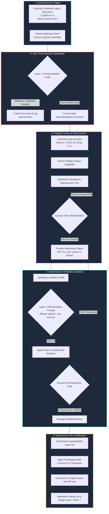

<div align="center">

# 🛠️ PatchPilot

### *The Autonomous AI Co-Maintainer for Open-Source Repositories*

**Triages incoming issues, reproduces bugs deterministically across polyglot codebases, and opens verified Pull Requests with passing tests — while you sleep.**

---

[](https://github.com/subhanirtaza2156/patchpilot)
[](https://opensource.org/licenses/Apache-2.0)
[](docs/SECURITY.md)
[](#-universal-polyglot-intelligence)
[](#-frontier-reasoning-engines)

---

[Quickstart Action](#-30-second-github-action-setup) • [How It Works](#-how-it-works-while-you-sleep) • [Live Bot Demo](#-the-bot-experience-on-github) • [Zero-Trust Security](#-zero-trust-cybersecurity-architecture) • [Documentation](docs/)

</div>

---

## ⚡ Why PatchPilot?

When you are actively writing code, tools like Cursor, Claude Code, and Copilot sit beside you.  
**But who maintains your repository when you are asleep, traveling, or focusing on high-level architecture?**

| Traditional Maintainer Nightmare 😫 | The PatchPilot Autonomous Workflow 🚀 |
| :--- | :--- |
| **Manual Issue Triage:** You spend hours deciphering unstructured, unformatted crash traces. | **Instant AST Indexing:** PatchPilot automatically isolates the exact file, class, and failing line. |
| **"Cannot Reproduce" Backlog:** Back-and-forth comments asking contributors for reproduction scripts. | **Deterministic RED State:** Writes a standalone reproduction test proving the bug exists. |
| **Hallucinated Suggestions:** Chatbots output speculative code that often breaks neighboring modules. | **Deterministic GREEN Loop:** Iteratively tests code in an isolated sandbox until 100% of test suites pass. |
| **Maintainer Burnout:** 70% of open-source time wasted triaging bugs instead of building features. | **1-Click Merge:** Wake up to clean, verified, test-backed Pull Requests waiting in your inbox. |

---

## 🔄 How It Works (While You Sleep)

PatchPilot runs headlessly in **GitHub Actions**. It requires zero local compute, zero central servers, and zero ongoing maintenance cost.



---

## 🤖 The Bot Experience on GitHub

When an issue is filed on your repository, PatchPilot executes autonomously:

### 1. Transparent Issue Comment
> 🔍 **PatchPilot Autonomous Bot** has picked up this issue.  
> Scanning codebase symbols, verifying reproduction test, and synthesizing secure patch in an isolated sandbox...

### 2. Ready-to-Merge Pull Request Opened
```markdown
## 🛠️ Autonomous Verified Fix for Issue #42

This pull request was autonomously synthesized, sandboxed, and verified by **PatchPilot**.

### 🧪 Verification & Quality Details:
- **Reproduction Test:** `tests/test_reproduce_42.py` (Confirmed RED state)
- **Iterations to Fix:** 1 iteration
- **Regression Test Suite:** ✅ All 48 tests passed (GREEN state)
- **Security Guardrail Audit:** ✅ Zero Protected Paths Modified

Closes #42
```

---

## 🚀 30-Second GitHub Action Setup

To turn on PatchPilot across your repository, simply create `.github/workflows/patchpilot.yml`:

```yaml
name: PatchPilot Autonomous Co-Maintainer

on:
  issues:
    types: [opened, labeled]

permissions:
  contents: write
  issues: write
  pull-requests: write

jobs:
  autonomous-fix:
    # Trigger automatically on bugs or issues labeled 'bug'
    if: contains(github.event.issue.labels.*.name, 'bug') || contains(github.event.issue.title, 'Fix') || contains(github.event.issue.title, 'bug')
    runs-on: ubuntu-latest

    steps:
      - name: Checkout Codebase
        uses: actions/checkout@v4
        with:
          fetch-depth: 0

      - name: Run PatchPilot Co-Maintainer
        uses: subhanirtaza2156/patchpilot@main
        with:
          openai-api-key: ${{ secrets.OPENAI_API_KEY }}
          # Or use Google Gemini 4 Argon:
          # gemini-api-key: ${{ secrets.GEMINI_API_KEY }}
          # llm-provider: "gemini"
```

---

## 🛡️ Zero-Trust Cybersecurity Architecture

Because PatchPilot operates autonomously on public repositories, it incorporates **military-grade application security guardrails**:

1. **Prompt Injection & Adversarial Jailbreak Defense:**  
   Every issue title and body is scanned against prompt injection heuristics (`ignore previous instructions`, `curl to external IP`, base64 obfuscation). Malicious issues are aborted and flagged immediately.
2. **Isolated Test Execution Sandbox (Anti-RCE):**  
   Synthesized test files undergo static AST security audits. Any invocation of `os.system()`, `subprocess.Popen()`, `socket.socket()`, or destructive filesystem primitives is blocked before execution.
3. **Unified Diff Boundary Firewall:**  
   Patches are strictly quarantined. PatchPilot **permanently forbids** modifying `.github/workflows/` (preventing CI privilege escalation), `.env`, SSH keys, or executing path traversal (`../../`).

---

## 🌐 Universal Polyglot Intelligence

PatchPilot is not limited to Python. Its native **Universal Code Scanner** maps symbols, exports, classes, and dependency graphs across:

| Language | Supported Extensions | Native Test Framework Integration |
| :--- | :--- | :--- |
| **Python** | `.py` | `pytest` / `unittest` |
| **TypeScript / JavaScript** | `.ts`, `.tsx`, `.js`, `.jsx` | `jest` / `vitest` / `npm test` |
| **Go** | `.go` | `go test ./...` |
| **Rust** | `.rs` | `cargo test` |
| **C / C++** | `.c`, `.cpp`, `.h` | Native make / ctest |

---

## 🧠 Frontier Reasoning Engines (BYOK)

PatchPilot interfaces directly with frontier AI models built specifically for agentic software engineering:

- **OpenAI:** Native integration with **GPT-6.1 Sol** (agentic coding), **GPT-6.1 Terra** (workflow automation), and OpenAI Codex.
- **Google Gemini:** Native integration with **Gemini 4 Argon** (advanced software engineering) and **Gemini 4 Carbon** (cybersecurity & deep reasoning).
- **Local Ollama (100% Offline):** Compatible with **DeepSeek-V4.1-Flash** (1M token context MoE) and **Qwen 2.5 Coder**.
- **Mock Provider:** Deterministic offline mode for testing, demos, and CI workflows.

---

## 💻 Optional Local CLI Usage

Maintainers can also run PatchPilot directly from their local terminal:

```bash
# Install locally
pip install patchpilot

# Scan polyglot repository
patchpilot scan .

# Triage incoming issue against codebase symbols
patchpilot triage "Crash in token parser" -b "Traceback at parser.ts:45"

# Autonomous Red-to-Green local solve
patchpilot solve "Crash in token parser" --provider openai
```

---

## 📂 Repository Directory Layout

```text
patchpilot/
├── action.yml                         # Official GitHub Action Manifest
├── examples/
│   └── patchpilot.yml                 # One-click workflow template
├── src/
│   └── patchpilot/
│       ├── bot/
│       │   └── github_bot.py          # Headless GitHub Actions Runner & PR Creator
│       ├── security/
│       │   └── guardrails.py          # Zero-Trust Prompt Injection & Diff Firewall
│       ├── core/
│       │   ├── universal_scanner.py   # Polyglot Code Scanner (PY, TS, GO, RS, C)
│       │   ├── issue_parser.py        # Stack trace & error extractor
│       │   └── orchestrator.py        # End-to-end controller
│       ├── runner/
│       │   └── multi_runner.py        # Polyglot Test Executor (pytest, jest, cargo, go)
│       ├── git/
│       │   └── worktree.py            # Isolated Git sandbox
│       └── llm/                       # GPT-6.1 Sol, Gemini 4 Argon, DeepSeek-V4.1
├── tests/                             # Comprehensive pytest test suite (21 passing)
├── pyproject.toml                     # Modern PEP 621 packaging
└── LICENSE                            # Apache 2.0 License
```

---

## 🤝 Contributing

Contributions are warmly welcomed! Please read our [Contributing Guide](docs/CONTRIBUTING.md) and [Code of Conduct](docs/CODE_OF_CONDUCT.md).

---

## 📄 License

Distributed under the **Apache-2.0 License**. See [LICENSE](LICENSE) for more information.

---

<div align="center">
Built with ❤️ for the global open-source community by <b><a href="https://github.com/subhanirtaza2156">Subhan Irtaza</a></b>.
</div>
