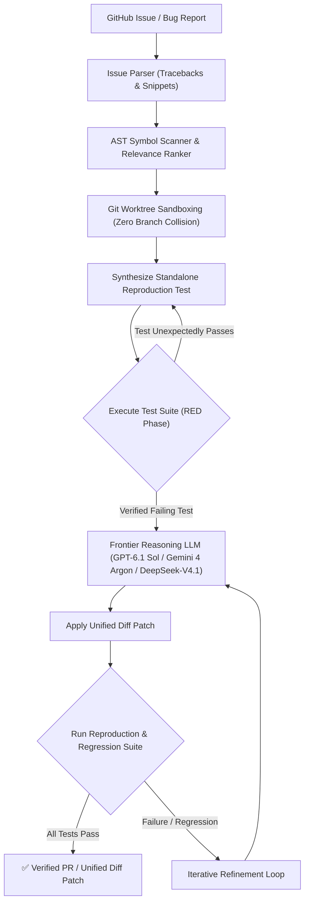

# 🛠️ PatchPilot

<div align="center">

[](https://github.com/subhanirtaza2156/patchpilot/actions)
[](https://opensource.org/licenses/Apache-2.0)
[](https://www.python.org/)
[](https://github.com/astral-sh/ruff)
[](docs/CONTRIBUTING.md)

**The Autonomous Issue-to-Verified-Patch Engine for Open Source Maintainers.**

*Reproduces bugs deterministically. Generates unified diffs. Verifies test suites in isolated sandboxes.*

[Quickstart](#-quickstart-in-60-seconds) • [Architecture](#-architecture) • [CLI Usage](#-cli-commands) • [Documentation](docs/) • [Contributing](docs/CONTRIBUTING.md)

</div>

---

## ⚡ The Problem

Open-source maintainers spend up to **70% of their maintenance time** triaging bug reports, deciphering unformatted stack traces, asking for reproduction snippets, and writing regression tests.

Standard AI coding assistants generate code suggestions, but they **cannot verify if the patch actually works**, often introducing subtle regressions that waste maintainer review cycles.

## 💡 The Solution: PatchPilot

`PatchPilot` is a local-first, zero-central-infra autonomous co-maintainer. It takes an incoming GitHub bug issue, scans the codebase using AST symbol analysis, creates an isolated Git worktree, writes a failing reproduction test (**RED**), synthesizes a verified code patch, and runs the entire test suite until all tests pass (**GREEN**).

---

## 🏗️ Architecture



---

## 🚀 Quickstart in 60 Seconds

### 1. Installation

Install directly via `pip` or clone the repository:

```bash
# Clone the repository
git clone https://github.com/subhanirtaza2156/patchpilot.git
cd patchpilot

# Install locally
pip install -e .
```

### 2. Scan Your Repository

Index all symbols, functions, classes, and dependencies using the local AST engine (zero tokens spent):

```bash
patchpilot scan .
```

### 3. Triage an Incoming Issue

Extract stack traces, detect exception types, and locate relevant code files:

```bash
patchpilot triage "Fix ZeroDivisionError in solver.py" -b "When solver receives empty matrix, it throws ZeroDivisionError"
```

### 4. Autonomously Solve and Verify

Run the full autonomous Red-to-Green verification loop:

```bash
# Using OpenAI Frontier Coding Models (GPT-6.1 Sol / GPT-6.1 Terra / Codex)
export OPENAI_API_KEY="your-api-key"
patchpilot solve "Fix ZeroDivisionError in solver.py" --provider openai --model gpt-6.1-sol

# Using Google Gemini Frontier Reasoning (Gemini 4 Argon / Gemini 4 Carbon)
export GEMINI_API_KEY="your-api-key"
patchpilot solve "Fix ZeroDivisionError in solver.py" --provider gemini --model gemini-4-argon

# Using 100% Free Local Models (DeepSeek-V4.1-Flash / Qwen 2.5 Coder)
patchpilot solve "Fix ZeroDivisionError in solver.py" --provider ollama --model deepseek-v4.1-flash

# Offline deterministic mock mode (for CI/CD and dry-runs)
patchpilot solve "Sample issue" --provider mock
```

---

## 💻 CLI Commands

| Command | Description | Example |
| :--- | :--- | :--- |
| `patchpilot scan [path]` | Scan directory & build AST symbol index | `patchpilot scan ./src` |
| `patchpilot triage <title>` | Rank relevant files & parse stack traces | `patchpilot triage "Crash on startup" -b "Traceback..."` |
| `patchpilot solve <title>` | Autonomous reproduction + patch + verify | `patchpilot solve "Issue title" --provider openai` |
| `patchpilot --version` | Display current PatchPilot version | `patchpilot --version` |

---

## 🔌 Supported Frontier LLM Providers (BYOK & Local-First)

PatchPilot runs **entirely on your machine**. Your code is never sent to any central server:

1. **OpenAI / Codex (BYOK):** Native support for **GPT-6.1 Sol** (agentic coding), **GPT-6.1 Terra**, **o3**, and OpenAI Codex.
2. **Google Gemini (BYOK):** Native support for **Gemini 4 Argon** (advanced software engineering & reasoning), **Gemini 4 Carbon** (cybersecurity & deep reasoning), and Gemini 2.5 Flash/Pro.
3. **Local Ollama (100% Offline & Private):** Optimized for **DeepSeek-V4.1-Flash** (1M token context MoE), **Qwen 2.5 Coder**, and Llama.
4. **Mock Provider:** Deterministic offline mode for testing, demos, and CI workflows.

---

## 🛡️ Key Features

- **AST Symbol Indexing:** Uses Python's native AST parser to map class hierarchies, argument signatures, and module dependencies without blowing LLM context budgets.
- **Git Worktree Isolation:** All patches and tests run in temporary `.patchpilot_worktrees/` branches. Your current working directory is never polluted.
- **Deterministic Red-to-Green Loop:** Guarantees patches solve the bug by first confirming a failing reproduction test, then verifying all regression suites pass.
- **Unified Diff Output:** Produces standard `git apply`-compatible patches ready for one-click merge or pull request submission.

---

## 📂 Repository Structure

```text
patchpilot/
├── .github/
│   ├── workflows/             # Automated CI, Linting, & Release Actions
│   └── ISSUE_TEMPLATE/        # Standard GitHub issue and PR templates
├── docs/
│   ├── ARCHITECTURE.md        # Technical specifications & design doc
│   ├── ROADMAP.md             # Milestone tracking & SWE-bench goals
│   ├── CONTRIBUTING.md        # Contributor guidelines & code style
│   ├── CODE_OF_CONDUCT.md     # Contributor Covenant v2.1
│   └── SECURITY.md            # Vulnerability disclosure policy
├── src/
│   └── patchpilot/
│       ├── cli.py             # Rich terminal CLI interface
│       ├── core/              # Orchestrator, AST RepoMap, Issue Parser
│       ├── git/               # Worktree sandboxing & diff generation
│       ├── llm/               # Multi-provider LLM abstraction layer
│       └── verifier/          # TestRunner & Red-to-Green verification loop
├── tests/                     # Comprehensive pytest test suite
├── pyproject.toml             # Modern PEP 621 packaging
└── LICENSE                    # Apache 2.0 License
```

---

## 🤝 Contributing

Contributions are warmly welcomed! Please read our [Contributing Guide](docs/CONTRIBUTING.md) and [Code of Conduct](docs/CODE_OF_CONDUCT.md) before submitting a Pull Request.

---

## 📄 License

Distributed under the **Apache-2.0 License**. See [LICENSE](LICENSE) for more information.

---

<div align="center">
Built with ❤️ for the global open-source maintainer community by <b><a href="https://github.com/subhanirtaza2156">Subhan Irtaza</a></b>.
</div>
